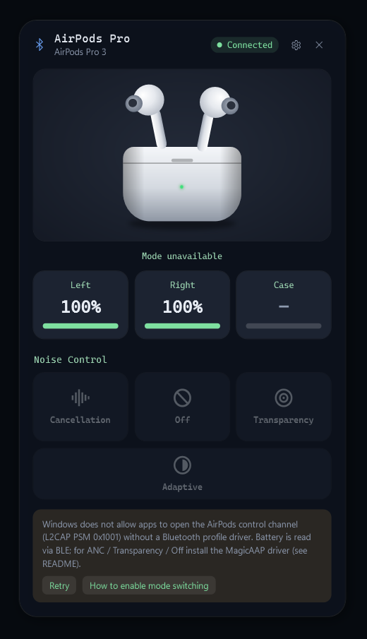

# AirPods Control для Windows

Нативная утилита для Windows 10/11 (x64): заряд AirPods и переключение режимов
**Noise Cancellation / Off / Transparency** (и Adaptive, если модель поддерживает).
Стек: .NET 10, WPF, MVVM, WinRT. Нет браузера, облака и регистрации. Работает в системном трее.



## Что работает сразу, а что требует драйвера

| Функция | Без драйвера | С драйвером MagicAAP |
|---|---|---|
| Обнаружение сопряжённых AirPods, модель, статус подключения | ✅ | ✅ |
| Заряд L / R / Case (BLE, шаг 10 %), зарядка, «в ухе» | ✅ | ✅ |
| Точный заряд (1 %) через AAP | — | ✅* |
| **ANC / Off / Transparency / Adaptive** с подтверждением от наушников | ❌ (интерфейс честно показывает причину) | ✅* |

\* Требуется проверка на оборудовании (см. «Процедура тестирования»).

**Почему нужен драйвер.** AirPods управляются по протоколу AAP через L2CAP-канал PSM 0x1001.
Windows открывает L2CAP классического Bluetooth только драйверам режима ядра. Winsock отклоняет L2CAP-сокет
(на тестовом ПК получено `WSAESOCKTNOSUPPORT`), а в WinRT такого API нет. Единственный существующий драйвер-мост — **MagicAAP**
от автора MagicPods. Подробности и источники — в [docs/PROTOCOL.md](docs/PROTOCOL.md).

## Установка

1. Сопрягите AirPods в *Параметры → Bluetooth и устройства*.
2. Запустите `AirPodsControl.exe` из portable-архива или установите `AirPodsControl-x.y.z-setup.exe`.
   Права администратора не нужны.
3. Значок появится в трее. Левый клик открывает панель у трея, правый — меню.

### Включение переключения режимов (MagicAAP)
> ⚠️ Решение за вами. На момент написания MagicAAP распространяется без подписи для обычной загрузки.
> Для установки нужно выключить Secure Boot и включить тестовый режим Windows. Это ослабляет защиту системы от неподписанных драйверов.
> Сторонние «community»-скрипты, которые просят отключить Defender и выполнить `irm … | iex`, этот проект **не рекомендует**.

1. Скачайте драйвер с официальной страницы MagicPods: <https://magicpods.app/magicaap/> и сверьте SHA-256 с указанным там.
2. Следуйте инструкции на этой странице: Secure Boot off → `bcdedit /set testsigning on` от администратора → перезагрузка → установка `MagicAAP.inf`.
3. Подключите AirPods, затем в AirPods Control нажмите **Retry**. Строка статуса должна смениться на «Control channel ready (L2CAP 0x1001)».
4. Чтобы откатить изменения: удалите драйвер в Диспетчере устройств (узел «AAP Server»), выполните `bcdedit /set testsigning off` и включите Secure Boot.

Приложение ничего из этого не делает само: оно не устанавливает драйверы и не меняет системные настройки.

## Использование

* **Кнопки режимов.** Нажатие отправляет команду AirPods. Кнопка подсвечивается только после того, как наушники
  вернули тот же режим. Если ответа нет или пришёл другой режим, панель показывает ошибку с объяснением.
* **Off на Pro 2 / Pro 3 / AirPods 4 ANC.** В прошивке Apple режим Off нужно разрешить. Опция *Settings → Allow 'Off' automatically* (по умолчанию включена)
  перед Off отправляет AirPods настройку «Allow Off Option» (как iPhone → AirPods → Off Listening Mode).
  Если её выключить и Off не разрешён на AirPods, наушники останутся в прежнем режиме, и панель это покажет.
* **Горячие клавиши** (настраиваются): `Ctrl+Alt+1` ANC, `Ctrl+Alt+2` Off, `Ctrl+Alt+3` Transparency.
  Если сочетание уже занято другим приложением, Windows не даст его зарегистрировать. Конфликт показывается в настройках.
* **Автозапуск:** *Settings → Start with Windows* (запись в `HKCU\…\Run`, старт свёрнутым в трей).
* **«—»** вместо процента означает, что данных нет (например, кейс закрыт или далеко). Случайные значения не подставляются.

### CLI `airpodsctl.exe` (proof of concept / диагностика)
```
airpodsctl diag                      состояние Bluetooth, AirPods, драйвер, проверка Winsock L2CAP
airpodsctl battery 20                заряд из BLE-рекламы в течение 20 с
airpodsctl mode anc|off|transparency|adaptive   отправить режим и дождаться подтверждения
airpodsctl monitor 30 -v             вывести все AAP-пакеты от AirPods
```

## Что фактически проверено (07.11.2026, Windows 11 26200, AirPods Pro 3)

| Проверка | Результат |
|---|---|
| Unit- и интеграционные тесты (52 шт., без железа) | ✅ все прошли |
| Обнаружение сопряжённых AirPods через BTHENUM (VID 004C / PID 2027) | ✅ |
| Имя, модель «AirPods Pro 3», статус «Connected» через WinRT | ✅ |
| BLE-заряд: L 100 % / R 100 % / Case «—» (кейс вне зоны), «в ухе» | ✅ совпадает с реальным состоянием |
| Winsock L2CAP-сокет | ❌ `WSAESOCKTNOSUPPORT (10044)`, как и ожидалось |
| Канал AAP / переключение ANC-Off-Transparency | ⏳ **требуется проверка на оборудовании**: MagicAAP на тестовом ПК не установлен |
| Точный заряд через AAP | ⏳ требуется проверка (тот же канал) |
| Ресурсы в трее (Release, single-file) | ~141 МБ working set / ~59 МБ private, ~1 % CPU одного ядра при пассивном BLE-сканировании, утечек за 30 с нет |

## Процедура тестирования на оборудовании

1. `airpodsctl diag`: AirPods найдены, `Connected: True`; при установленном драйвере `Control: Available`.
2. `airpodsctl battery 20`: при открытом кейсе или наушниках вне кейса значения совпадают с iPhone с точностью ±10 %.
3. `airpodsctl monitor 15 -v`: после handshake приходят пакеты `04 00 04 00 04 00 …` (батарея), `… 09 00 0D xx …` (текущий режим), `… 1D …` (метаданные).
4. `airpodsctl mode anc`: ожидается `Result: Confirmed`, шум слышно подавляется. Повторите для `transparency` и `off`.
5. `airpodsctl mode off` при выключенном на iPhone «Off Listening Mode» и снятой галочке Allow 'Off' automatically:
   ожидается `DeviceReportedDifferentMode` или `NoResponse`, но не ложный успех.
6. В GUI: переключите режим долгим нажатием на ножку. Подсветка должна смениться сама (уведомление от AirPods).
7. Во время воспроизведения музыки переключите режимы: звук не должен прерываться, устройство вывода не должно меняться.
8. Выключите и включите Bluetooth, уберите AirPods в кейс и достаньте снова: статус «Disconnected» → «Connected», канал восстанавливается автоматически
   (повторы через 3 / 10 / 30 / 60 / 180 с).

Пришлите вывод шагов 3–5 (`-v`) из `%LOCALAPPDATA%\AirPodsControl\logs`, если что-то отличается.

## Сборка

Требования: .NET SDK 10, Windows 10 19041+ SDK (подтягивается через NuGet). Для установщика нужен Inno Setup 6 (необязательно).
```
.\build.ps1
```
Скрипт запускает unit-тесты, собирает self-contained single-file `win-x64` в `dist\AirPodsControl-portable`
и создаёт zip. Если найден `ISCC.exe`, дополнительно собирается установщик.

## Архитектура

```
src/AirPodsControl.Core      (net10.0, без Windows API — полностью покрывается тестами)
  Protocol/AapPackets        сборка AAP-пакетов (handshake, 0x4D, 0x0F, 0x0D, 0x34)
  Protocol/AapParser         разбор батареи, ear detection, control, metadata
  Protocol/ProximityPairing  разбор BLE-рекламы 0x07
  Models/AirPodsCatalog      PID ↔ модель ↔ возможности (Support.Yes/No/Unverified)
  Services/AirPodsProtocolService  сессия AAP, handshake, ожидание эха команд
  Services/NoiseControlManager     переключение режимов, только подтверждённое состояние
  Services/BatteryMonitor          слияние AAP (1 %) и BLE (10 %), устаревание данных
src/AirPodsControl.Windows   BluetoothDeviceManager (CfgMgr32 + WinRT), BleAdvertisementSource,
                             AapControlChannel/DriverAapTransport (MagicAAP), AirPodsController (переподключение)
src/AirPodsControl.App       WPF: MainWindow (панель), SettingsWindow, трей, HotkeyService, SettingsService
src/AirPodsControl.Cli       airpodsctl
tests/AirPodsControl.Tests   xUnit: векторы из документации LibrePods/AirPodsDesktop + интеграционные тесты со скриптовым транспортом
```

Ресурсы: декоративные анимации работают только при видимом окне. Плавание наушников ограничено 30 fps,
BLE-сканирование пассивное, фоновых циклов отрисовки нет. Логи хранятся в `%LOCALAPPDATA%\AirPodsControl\logs`
(7 дней, без персональных данных, кроме MAC-адреса наушников), настройки — в `%APPDATA%\AirPodsControl\settings.json`.

## Источники
* LibrePods — https://github.com/librepods-org/librepods (протокол AAP, возможности моделей)
* AirPodsDesktop — https://github.com/SpriteOvO/AirPodsDesktop (формат BLE proximity pairing, PID моделей)
* AirPodsWindows — https://github.com/YimingZhanshen/AirPodsWindows (интерфейс драйвера MagicAAP)
* MagicPods / MagicAAP — https://magicpods.app/magicaap/

«AirPods» — товарный знак Apple Inc. Проект не связан с Apple.
