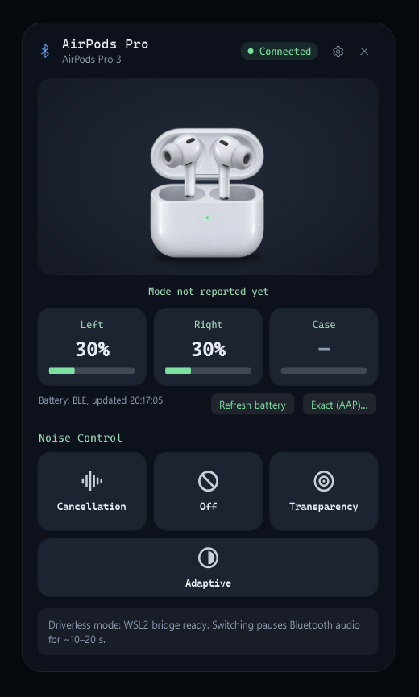

# AirPods Control для Windows

[English](README.md) · **Русский**

**Переключение шумоподавления AirPods, режимов Прозрачность, Адаптивный и Off на Windows 10/11 и настройка того, что делает
удержание ножки. Без тестового режима Windows, без отключения Secure Boot, без неподписанных драйверов, без iPhone и Mac.**

Небольшая программа в трее (.NET 10, WPF): показывает заряд AirPods и переключает режимы, которые сама Windows менять не умеет.
Без браузера, облака, регистрации и телеметрии.



> **Статус: ранняя версия, проверена на одном ПК** (Windows 11 26200, Bluetooth MediaTek MT7922, AirPods Pro 3). Другие
> адаптеры и модели AirPods не проверялись. Перед установкой прочитайте [ограничения](#ограничения).

## Без тестового режима — запустил и один раз настроил

Другие способы управлять режимами AirPods в Windows требуют неподписанного драйвера ядра, а значит — отключить Secure Boot и
включить тестовый режим Windows. **AirPods Control этого не требует.** С AirPods он общается через встроенный в Windows WSL2:

1. Распакуйте архив и запустите `AirPodsControl.exe` — ничего не устанавливается, драйверов нет.
2. Один раз нажмите **Set up driverless mode**. Мастер всё подготовит сам (Linux вручную ставить не нужно) и **один раз**
   попросит права администратора.
3. Дальше — просто кнопка режима или горячая клавиша. Без прав администратора и перезагрузок; Secure Boot и параметры
   безопасности Windows не меняются.

Что нужно заранее: установленный WSL2 (`wsl --install`), Bluetooth-адаптер на USB (встроенный Bluetooth ноутбуков обычно такой),
а для адаптеров MediaTek — ядро WSL от AirPods Control, которого в текущем релизе **нет** (см. [ограничения](#ограничения)).

## Для кого

- **Владельцы AirPods на Windows**, которым нужно просто переключать шумоподавление / Прозрачность / Off с компьютера или
  настроить, чтобы ножка переключала Off, ANC, Прозрачность и Адаптивный, — без iPhone.
- **Разработчики и исследователи**: рабочий и задокументированный способ говорить с AirPods по протоколу Apple AAP из Windows
  без драйвера ядра; описание протокола с источниками — [docs/PROTOCOL.md](docs/PROTOCOL.md), исследование драйверов —
  [docs/WINDOWS-DRIVER-RESEARCH.md](docs/WINDOWS-DRIVER-RESEARCH.md), CLI для скриптов.
- **Компании и интеграторы**: лицензия MIT, никаких сетевых сервисов, логи остаются на компьютере.

## Что работает

| Функция | Как | Проверено на железе |
|---|---|---|
| Поиск сопряжённых AirPods, модель, подключение | API Windows, без настройки | ✅ |
| Заряд L / R / кейс (шаг 10 %), зарядка, «в ухе» | BLE-реклама, без настройки | ✅ |
| Переключение ANC / Off / Прозрачность / Адаптивный | WSL2-мост (ниже) или драйвер MagicAAP | ✅ через WSL2-мост (на слух); путь MagicAAP не проверен |
| Точный заряд (1 %) | WSL2-мост, по запросу | ✅ |
| Режимы удержания ножки (в том числе Off), записываются в AirPods | WSL2-мост, Settings → *Press and hold* | ✅ применяются (на слух); сохранение после переподключения и кейса **не проверено** |
| Горячие клавиши, автозапуск, меню в трее | — | ✅ |

Через мост AirPods не присылают подтверждения, поэтому программа пишет о командах **«sent» (отправлено)**, а не «confirmed».

## Ограничения

Известные минусы текущей версии — честно:

- **Память: около 900 МБ ОЗУ, пока мост активен.** Виртуальная машина WSL2 с ядром AirPods Control (`vmmemWSL` в диспетчере
  задач) остаётся запущенной между командами. **Это будет исправлено в ближайших обновлениях** (остановка ВМ в простое и
  ограничение её памяти). Пока что память освобождает `wsl --shutdown`; следующая команда запустит ВМ снова.
- **Bluetooth пропадает примерно на 12–15 с на каждую команду.** На время команды USB-адаптер передаётся в WSL и затем
  возвращается Windows: звук прерывается, AirPods переподключаются. Быстрые повторные нажатия объединяются в одну паузу.
- **Релиз без ядра для MediaTek.** Лицензия прошивки MediaTek не разрешает распространять её внутри ядра Linux, поэтому в
  публичном архиве ядра нет. Владельцы MediaTek один раз собирают его скриптом `kernel/build-kernel.sh` (≈30 мин, см.
  [docs/RELEASING.md](docs/RELEASING.md)). Это ядро действует на **все** ваши дистрибутивы WSL.
- **Адаптеры:** проверены только MediaTek MT7921/MT7922/MT7925 (на практике MT7922). Intel, Realtek, Broadcom: прошивка пока не
  ставится — скорее всего, не заработают. Bluetooth должен быть подключён по USB.
- **Проверено на одном ПК и одной модели (AirPods Pro 3).** Другие модели с шумоподавлением должны работать, но не проверены.
- **AirPods не подтверждают команды:** результат — «отправлено». Сохраняется ли набор удержания после переподключения и кейса,
  не проверено.
- **Разовые требования:** WSL2, один раз права администратора, интернет во время настройки.
- **Exe не подписан:** SmartScreen предупреждает при первом запуске (*Подробнее → Выполнить в любом случае*).
- Только Windows 10/11 x64.

## Почему это сложно в Windows

AirPods управляются протоколом Apple AAP через Bluetooth-канал L2CAP (PSM 0x1001). В Windows такой канал могут открыть только
драйверы режима ядра: Winsock отклоняет L2CAP-сокет (`WSAESOCKTNOSUPPORT`), а в WinRT такого API нет.
Подробности и источники — [docs/PROTOCOL.md](docs/PROTOCOL.md).

Обходных путей два:

1. **Driverless mode (WSL2-мост)** — рекомендуется: без Test Mode, без отключения Secure Boot, без драйвера.
   На время каждой команды программа передаёт USB-адаптер Bluetooth маленькому Alpine Linux в WSL2 (через usbipd-win),
   Linux отправляет AAP-команду, и адаптер всегда возвращается Windows.
2. **Драйвер MagicAAP** от автора MagicPods — мгновенно, но не подписан: нужно выключить Secure Boot и включить тестовый режим
   Windows. Программа его не устанавливает; см. [docs/WINDOWS-DRIVER-RESEARCH.md](docs/WINDOWS-DRIVER-RESEARCH.md).

## Требования (driverless mode)

- Windows 10/11 x64, виртуализация включена в BIOS/UEFI.
- **Установлен WSL2.** Если нет — выполните `wsl --install` от администратора и перезагрузитесь; сама программа WSL не ставит.
- Bluetooth-адаптер, подключённый по **USB** (встроенный Bluetooth ноутбуков обычно такой).
- AirPods сопряжены с Windows (*Параметры → Bluetooth и устройства*).
- Интернет на время разовой настройки.

## Установка

1. Скачайте `AirPodsControl-x.y.z-win-x64-portable.zip` из [Releases](../../releases) и распакуйте в любую папку.
2. Запустите `AirPodsControl.exe`. SmartScreen может предупредить, потому что exe не подписан (*Подробнее → Выполнить в любом случае*).
3. Нажмите **Set up driverless mode (WSL2)** (или *Settings → Driverless setup*). Мастер сам:
   - создаёт отдельный дистрибутив WSL `airpods-bridge` из Alpine minirootfs (~4 МБ, проверка SHA-256) и ставит в него
     BlueZ + Python (~40 МБ);
   - ставит [usbipd-win](https://github.com/dorssel/usbipd-win) через `winget`, если его нет;
   - **один раз** просит права администратора: открыть доступ к адаптеру через usbipd и скопировать ключ сопряжения
     **только этих AirPods** в этот дистрибутив;
   - для адаптеров MediaTek предлагает переключить WSL на ядро AirPods Control (см. ниже);
   - проверяет адаптер и связь с AirPods.

   Ставить Linux вручную не нужно. После настройки права администратора больше не требуются.
4. **Remove driverless mode** в мастере удаляет дистрибутив (вместе с ключом), закрывает доступ к адаптеру и убирает строку ядра.

### Ядро WSL (только MediaTek) — важно

В ядре WSL от Microsoft нет поддержки Bluetooth MediaTek. Ядро AirPods Control — это ядро Microsoft той же версии с включённым
MediaTek Bluetooth и встроенной прошивкой MT7921/MT7922/MT7925 ([kernel/](kernel/)). Оно прописывается в
`%UserProfile%\.wslconfig` (с резервной копией) и **действует на все ваши дистрибутивы WSL** (Ubuntu, Docker Desktop и т. д.).

> **О релизах:** лицензия прошивки MediaTek разрешает её распространение, но *не в составе ядра Linux*. Пока вопрос не решён,
> публичные релизы выходят **без** ядра; его можно собрать самостоятельно скриптом `kernel/build-kernel.sh`
> (≈30 мин) — см. [docs/RELEASING.md](docs/RELEASING.md).

## Использование

- **Кнопки режимов и горячие клавиши** (`Ctrl+Alt+1` ANC, `Ctrl+Alt+2` Off, `Ctrl+Alt+3` Прозрачность; настраиваются).
  Нажатия во время идущего переключения объединяются с ним (побеждает последнее) и не вызывают ещё одного разрыва Bluetooth.
- **Заряд:** *Refresh battery* ждёт свежую BLE-рекламу (без прерывания, ±10 %). *Exact (AAP)…* после предупреждения читает
  точные значения через мост. Старые значения остаются на экране с временем получения — нулём не заменяются.
- **Удержание ножки (Settings):** отметьте режимы, между которыми должна переключать ножка (не меньше двух; при Off
  отправляется и «Allow Off»), и нажмите **Apply to AirPods**. Флажки — это *желаемый* набор; строка под ними показывает, что
  AirPods действительно сообщили или подтвердили. Обычно там «Current AirPods set: unknown»: через мост AirPods ничего не сообщают.
  Назначение удержания (Siri или управление шумом) программа не меняет.
- **Защита Bluetooth-мыши и клавиатуры:** если через тот же адаптер подключены мышь или клавиатура (или это не удаётся
  определить), любая передача адаптера блокируется до явного подтверждения (по умолчанию «Нет»).

### CLI `airpodsctl.exe`

```
airpodsctl diag                       Bluetooth, сопряжённые AirPods, канал управления
airpodsctl battery 20                 заряд из BLE в течение 20 с
airpodsctl bridge-status              готовность driverless mode
airpodsctl bridge-check               какой адаптер будет передан и какие устройства ввода он обслуживает (ничего не меняет)
airpodsctl bridge-mode anc|off|transparency|adaptive[,режим…] [--trace]   переключить через мост, напечатать трассу операции
airpodsctl bridge-battery             точный заряд по AAP
airpodsctl bridge-hold-cycle --modes off,anc,transparency[,adaptive]     записать режимы удержания ножки
airpodsctl bridge-enable-off (--modes anc,… | --keep-current)            то же, Off добавляется всегда
airpodsctl kernel-status | kernel-install | kernel-remove                ядро WSL для MediaTek
  --allow-input-loss                  явно разрешить потерю Bluetooth-мыши/клавиатуры (общий --yes этого не делает)
```

## Частые вопросы

**Как включить шумоподавление AirPods на Windows?** В самой Windows такой настройки нет. Установите AirPods Control, один раз
пройдите настройку driverless mode, затем нажмите *Noise Cancellation* или `Ctrl+Alt+1`.

**Можно ли переключить AirPods Pro в режим прозрачности или Off с компьютера без iPhone?** Да — именно это программа и делает,
включая Адаптивный режим на моделях, где он есть.

**Нужны ли тестовый режим, отключённый Secure Boot или особый драйвер?** Нет. Driverless mode работает через WSL2 и usbipd-win.
Они нужны только для необязательного драйвера MagicAAP, который программа не устанавливает.

**Можно ли добавить Off в переключение удержанием ножки без Mac и iPhone?** Да: *Settings → Press and hold*, отметьте режимы,
*Apply to AirPods*.

**Почему звук пропадает на несколько секунд?** На время команды адаптер передаётся в WSL — см. [ограничения](#ограничения).

**Почему `vmmemWSL` занимает около 900 МБ памяти?** ВМ WSL не останавливается между командами. Исправление запланировано;
сейчас память освобождает `wsl --shutdown`.

**Работает ли с AirPods Pro 2 / AirPods 4 / AirPods Max?** Не проверялось. Модели с шумоподавлением должны работать, если ваш
адаптер Bluetooth поддерживается, — пишите о результатах в Issues.

## Сборка из исходников

Нужны .NET 10 SDK; Python 3 для тестов моста (необязательно); Inno Setup 6 для установщика (необязательно).

```
.\build.ps1             # тесты + self-contained single-file сборка win-x64 + zip в .\dist
.\build.ps1 -NoKernel   # то же, без ядра WSL для MediaTek
```

Ядро в git не хранится. Его собирает `kernel/build-kernel.sh` (от root в любом Alpine-дистрибутиве WSL) в `assets\wsl-kernel\`,
после чего `build.ps1` добавляет его в архив. Тесты: `dotnet test tests\AirPodsControl.Tests` (154) и
`python -m unittest discover -s tests/bridge` (61).

## Приватность

- Никакой телеметрии и учётных записей. Сеть нужна только при настройке (образ Alpine, пакеты Alpine, usbipd-win через winget).
- Ключ сопряжения AirPods копируется только в локальный дистрибутив WSL `airpods-bridge` и удаляется вместе с ним.
- Логи (`%LOCALAPPDATA%\AirPodsControl\logs`, 7 дней) содержат Bluetooth-адрес AirPods; настройки — в `%APPDATA%\AirPodsControl`.

## Документация

- [docs/WSL-BRIDGE.md](docs/WSL-BRIDGE.md) — устройство моста · [docs/BRIDGE-OPERATIONS.md](docs/BRIDGE-OPERATIONS.md) — одна
  операция = одна передача адаптера, трассы, защита устройств ввода, режимы удержания · [docs/PROTOCOL.md](docs/PROTOCOL.md) —
  форматы AAP и BLE с источниками · [docs/RELEASING.md](docs/RELEASING.md) — чек-лист релиза.

## Лицензии и благодарности

- AirPods Control: [MIT](LICENSE).
- Ядро WSL (только если входит в сборку): GPL-2.0 — исходники: [WSL2-Linux-Kernel](https://github.com/microsoft/WSL2-Linux-Kernel)
  от Microsoft (тег в `BUILDINFO`) и [kernel/patches](kernel/patches); встроенная прошивка MediaTek:
  [kernel/LICENCE.mediatek](kernel/LICENCE.mediatek).
- usbipd-win (GPL-3.0) и пакеты Alpine/BlueZ мастер скачивает из официальных источников, в сборку они не входят.
- Знания о протоколе: [LibrePods](https://github.com/librepods-org/librepods) (AAP),
  [AirPodsDesktop](https://github.com/SpriteOvO/AirPodsDesktop) (формат BLE, ID моделей),
  [AirPodsWindows](https://github.com/YimingZhanshen/AirPodsWindows) (интерфейс MagicAAP), [MagicPods](https://magicpods.app/magicaap/).

«AirPods» — товарный знак Apple Inc. Проект не связан с Apple.

<sub>Ключевые слова: AirPods Windows, AirPods на компьютере, AirPods на ПК, шумоподавление AirPods на Windows, включить
шумоподавление AirPods на ноутбуке, режим прозрачности AirPods Windows, адаптивный режим AirPods, выключить шумоподавление
AirPods, удержание ножки AirPods, добавить Off в AirPods, заряд AirPods на Windows, AirPods Pro 3 Windows 11, AirPods без iPhone,
управление AirPods без тестового режима, без драйвера, без отключения Secure Boot, протокол AAP, WSL2 Bluetooth, usbipd ·
AirPods noise cancellation Windows, AirPods transparency mode PC.</sub>
